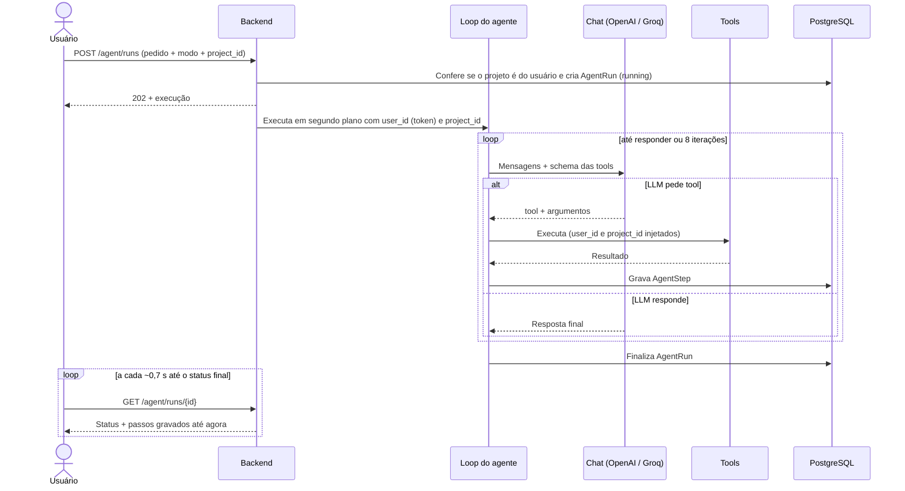
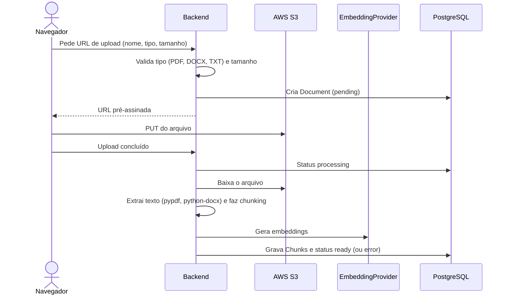

# Agente e RAG

> Status: **implementado**. Pronto: documentos (upload, processamento em segundo plano com extração, chunking e embeddings, lista e exclusão), busca híbrida, as tools de leitura, o **loop do agente** (fallback OpenAI → Groq, limite de 8 iterações, passos gravados ao vivo), a API `/agent/runs` e todas as tools, incluindo `generate_image` e `analyze_performance`. Primeira execução real feita localmente em 09/11 (34 s, 5 tools, fontes citadas). Stack definida na [decisão 34](decisoes.md): LangChain 1.x + LangGraph, OpenAI com fallback para o Groq, LangSmith.

## Stack

| Papel | Escolha | Pacote |
| --- | --- | --- |
| Loop do agente | `create_agent` do LangChain (construído sobre o LangGraph) | `langchain` (traz `langgraph`) |
| Chat (tool calling) | OpenAI, com **fallback automático** para o Groq (modelo aberto, plano gratuito) quando a OpenAI falha ou atinge limite | `langchain-openai`, `langchain-groq` |
| Embeddings | OpenAI `text-embedding-3-small` (1536 dimensões; a dimensão vem da configuração) | `langchain-openai` |
| Geração de imagem | OpenAI, versão mínima: uma imagem **sem texto** para a biblioteca do projeto; o texto entra depois no editor de arte | `openai` |
| Busca web | Tavily (plano gratuito), chamado com `httpx` | — |
| Busca nos documentos | **Própria:** pgvector (HNSW) + `tsvector` (GIN) + RRF em SQL | `pgvector` |
| Extração de texto | PDF e DOCX (TXT direto) | `pypdf`, `python-docx` |
| Rastreio | LangSmith, **só em produção**; desligado nos testes e no CI (`LANGSMITH_TRACING=false`) | `langsmith` |

- Os modelos concretos só são criados em `ai/models.py`, a partir das variáveis de ambiente; o resto do código usa as interfaces do LangChain (`BaseChatModel`, `Embeddings`), então trocar de modelo é configuração.
- **Chaves** (`OPENAI_API_KEY`, `GROQ_API_KEY`, `TAVILY_API_KEY`, `LANGSMITH_API_KEY`) só no `.env` local e na Render, nunca no frontend. Na OpenAI, limite mensal de gasto configurado na conta.
- A integração PGVector do LangChain **não** é usada: não tem full-text e cria tabelas próprias.

## Loop do agente

`create_agent` do LangChain: o LLM recebe o pedido e as tools, decide qual chamar, recebe o resultado e repete até responder. Implementado em `ai/agent/runner.py` (`run_agent`), com três middlewares do LangChain em volta do loop:

| Middleware | Papel |
| --- | --- |
| `ModelCallLimitMiddleware(run_limit=8)` | No máximo 8 chamadas ao modelo (iterações). Se a 8ª ainda pede tools, a execução termina em `limit_reached` |
| `ModelFallbackMiddleware(Groq)` | Quando a chamada à OpenAI falha (fora do ar, limite), o Groq (`openai/gpt-oss-120b`) responde no lugar |
| `StepRecorder` (próprio) | `awrap_model_call` conta as iterações; `awrap_tool_call` cronometra cada tool e grava o `AgentStep` assim que ela termina (num `finally`, então o passo com erro também é gravado) e escreve o log |

- **Numeração:** o passo recebe o número quando a chamada começa, porque tools pedidas juntas podem terminar fora de ordem.
- **Tempo máximo:** 180 s por execução (`RUN_TIMEOUT_SECONDS`); passou disso, `error`.
- **Execução interrompida:** se um deploy ou reinício derruba o processo no meio, a execução ficaria `running` para sempre. Ao ler (`GET`), uma execução `running` há mais de 4 minutos é fechada como `error` ("interrompida"), para a tela parar de esperar.
- **LangSmith:** cada execução vai com `run_name = agent-run-{id}` e a tag do modo, para achar o rastro quando o tracing está ligado.

- **Execução em segundo plano, passos ao vivo.** `POST /agent/runs` responde `202` na hora com `status: "running"` e o loop roda em segundo plano, gravando cada `AgentStep` assim que a tool termina. A tela consulta `GET /agent/runs/{id}` a cada ~0,7 s até o status final e mostra os passos conforme aparecem. Sem WebSocket nem SSE, e funciona com 2 réplicas, porque o estado fica no banco.
- **Máximo de 8 iterações.** Ao atingir o limite, a execução termina com `limit_reached` e o usuário é avisado. Várias tools pedidas pelo LLM na mesma resposta (ex.: adaptar para LinkedIn e para X) contam como uma iteração.
- **Erro numa tool:** uma exceção encerra a execução com `error`, e o passo guarda a mensagem em `error`. Erros de uso (id inválido, texto acima do limite) não são exceções: a tool devolve `{"error": "…"}` com uma dica e o modelo corrige a chamada.
- **Cada pedido é independente:** a conversa na tela é uma sequência de execuções; o agente não recebe o histórico das anteriores.
- **Prompts de sistema** separados por modo em `ai/agent/prompts/`.
- **Segurança:** o `user_id` e o `project_id` são injetados pelo backend em toda tool. Eles não aparecem no schema que o LLM vê: o agente só enxerga os dados do projeto em que foi chamado, e os documentos de um cliente nunca entram nos posts de outro.
- **Voz da marca:** o público-alvo e o tom de voz vêm do assunto; quando o assunto não define, valem os do projeto.
- **Rastreabilidade:** cada passo (tool, argumentos, duração, erro) vira log estruturado e registro em `AgentStep`.

## Modos

| Modo | Objetivo | Tools mais usadas |
| --- | --- | --- |
| Ideação (`ideation`) | Sugerir temas | `get_project`, `list_subjects`, `search_past_posts`, `search_documents`, `search_web`, `analyze_performance` (só leitura: nunca salva) |
| Criação (`creation`) | Escrever e salvar o post | as de leitura + `adapt_for_network`, `generate_image` e `save_draft` |

As tools de cada modo ficam em `ai/tools/registry.py` (`TOOLS_BY_MODE`); um teste garante que a ideação não tem tools de escrita. Os prompts (`ai/agent/prompts/ideation.md` e `creation.md`) dizem a ordem de trabalho, citam as tools pelo nome e proíbem inventar fatos.

## Tools

Uma por arquivo em `ai/tools/`, `@tool` do LangChain com schema de entrada em Pydantic. Nomes em inglês (ver [decisão 20](decisoes.md)); as descrições que o LLM recebe podem ficar no idioma dos prompts.

| Tool | O que faz |
| --- | --- |
| `search_web(query)` | Tavily: até 5 resultados com título, URL e trecho (500 caracteres). Se o Tavily falhar, responde "continue sem ela" e a execução segue |
| `get_project()` | Dados do projeto atual: nome, descrição, público-alvo e tom de voz padrão |
| `list_subjects()` | Lista os assuntos do projeto |
| `get_subject(id)` | Detalhes do assunto, com público-alvo e tom de voz já resolvidos (do assunto ou, se vazios, do projeto) |
| `search_documents(query)` | RAG híbrido nos documentos do projeto |
| `search_past_posts(subject)` | Exemplos de estilo do projeto, só de posts aprovados ou publicados |
| `analyze_performance()` | Sem IA: pega a coleta mais recente de cada variação com métricas e agrupa por assunto, rede, dia da semana, período do dia (madrugada, manhã, tarde, noite) e com ou sem imagem. Dia e hora no fuso de São Paulo, calculados pelo Postgres. Cada grupo traz a média de impressões e de taxa de engajamento (interações ÷ impressões, a mesma regra da tela de métricas). Grupo com menos de 5 posts mostra só o tamanho (`enough_data: false`); com menos de 5 no total, responde que os dados são insuficientes. A agregação é uma função pura (`summarize`), testada sem banco |
| `adapt_for_network(text, network)` | Sem IA: devolve o limite de caracteres da rede (o mesmo `CHAR_LIMIT` do formulário), o tamanho do texto, se cabe, quanto passou e o estilo que funciona na rede. O modelo reescreve e confere de novo |
| `generate_image(prompt, format)` | OpenAI `gpt-image-1-mini` (qualidade `IMAGE_QUALITY`, padrão `low`, cerca de US$ 0,005 por imagem). `format`: `square` (1024×1024), `portrait` (1024×1536) ou `landscape` (1536×1024). O prompt sempre ganha "sem texto, letras, logos ou marcas d'água". O PNG vai para o S3 e entra na biblioteca de imagens do projeto (`images`). **No máximo 1 por execução** (conferido nos passos gravados), para controlar o custo. Se o provedor falhar ou recusar o prompt, ou sem chave, devolve um erro e o post segue sem imagem |
| `save_draft(title, subject_id, variations, image_id?)` | Salva o post com uma variação por rede, sempre `draft`, validado com as mesmas regras do formulário (`PostIn`). Com `image_id` (de `generate_image`), todas as variações viram `single` com a imagem; a imagem precisa ser do projeto. Sem imagem: `text` (LinkedIn e X) ou `single` sem imagem (Instagram, que não tem só texto). Liga o post à execução (`post_id`) |

## Plano de implementação

Uma branch e um PR por etapa; cada merge vai para produção pelo pipeline.

| Dia | Branch | Entrega |
| --- | --- | --- |
| 09/11 | `feat/ai-documents` | Decisão 34 e docs, dependências e configuração, migration (`documents`, `chunks`, `agent_runs`, `agent_steps`, extensão `vector`), API de documentos (URL de upload, processamento, lista, exclusão) |
| 10/11 | `feat/ai-search-tools` | Busca híbrida (RRF) e tools de leitura: `get_project`, `list_subjects`, `get_subject`, `search_documents`, `search_past_posts` |
| 08–09/11 | `feat/ai-agent` | `create_agent` com fallback OpenAI → Groq, `/agent/runs` (202 + polling), passos em `agent_steps`, `save_draft`, `adapt_for_network`, `search_web`, prompts por modo ✅ |
| 09/11 | `feat/ai-agent-2` | `generate_image` (mínima), `analyze_performance`, `image_id` no `save_draft`, prompts atualizados ✅ |
| 09/11 | `feat/ai-frontend` | Tipos do frontend em inglês, páginas ligadas à API real, testes ✅ |
| 14/11 | — | Produção (chaves na Render), teste ponta a ponta, docs |

Se o prazo apertar (ordem de corte do CLAUDE.md): sai primeiro `analyze_performance`, depois `generate_image`. Documentos, RAG, busca web, o loop e `save_draft` nunca são cortados.

## Pipeline de documentos (RAG)

### Como está implementado

- `ai/rag/extract.py`: texto do PDF (pypdf, página a página), do DOCX (python-docx, parágrafos e uma linha por linha de tabela) e do TXT (UTF-8, com ou sem BOM, ou Latin-1). Arquivo corrompido ou sem texto (PDF escaneado) vira `ExtractionError`, com mensagem para o usuário.
- `ai/rag/chunking.py`: chunks de até **1.200 caracteres** (cerca de 300 tokens) com **200 de sobreposição**, quebrando por parágrafo, depois por frase e, em último caso, entre palavras. Por caracteres, sem tokenizador; o splitter do LangChain fica num pacote à parte (`langchain-text-splitters`), então foi escrito um próprio, coberto por testes.
- `ai/models.py`: `get_embeddings()` cria o `OpenAIEmbeddings` a partir da configuração (com o repositório de certificados do sistema, como no Auth0). Sem `OPENAI_API_KEY`, o processamento responde `503`.
- `ai/rag/ingest.py`: `process_document` roda em segundo plano (`BackgroundTasks` do FastAPI) com sessão própria (`get_session_factory`): baixa do S3, extrai, divide, gera os embeddings em lote, substitui os chunks e marca `ready`; em erro, desfaz a transação e marca `error`. Os logs registram o id e o número de chunks, nunca o conteúdo.
- O `search_vector` é coluna gerada pelo Postgres (`to_tsvector('portuguese', content)`), então nunca fica desatualizado.

## Busca híbrida

`search_documents` combina:

1. **Similaridade vetorial** (pgvector, índice HNSW) sobre o embedding da consulta.
2. **Full-text** (`tsvector` em português) sobre o conteúdo.

Os dois rankings são combinados com **Reciprocal Rank Fusion** (RRF): cada trecho soma `1 / (60 + posição)` em cada ranking em que aparece. Só as posições contam, então as notas dos dois métodos (que não são comparáveis) nunca são misturadas, e um trecho bem colocado nos dois sobe para o topo.

- Implementação em `ai/rag/search.py` (`search_chunks`): cada método traz até 20 candidatos e a fusão devolve os 5 melhores, com o nome do documento.
- **Full-text:** `websearch_to_tsquery('portuguese', …)`, que aceita texto livre sem erro de sintaxe e faz a redução das palavras ("backups" encontra "backup"); ordem por `ts_rank`.
- **Vetorial:** distância de cosseno (`<=>`) sobre o índice HNSW.
- A consulta **sempre** filtra por `user_id` e `project_id` (via `Document`) e só usa documentos `ready`.

## Contexto das tools

Toda tool recebe o contexto da execução (`ai/agent/context.py`, `AgentContext`: `user_id`, `project_id`, a fábrica de sessões do banco e o modelo de embeddings) pelo parâmetro `runtime: ToolRuntime[AgentContext]` do LangChain. Esse parâmetro **não entra no schema enviado ao modelo**: o LLM só preenche os argumentos de conteúdo (`query`, `subject_id`). Um teste de unidade (`tests/unit/test_tool_schemas.py`) confere, para cada tool, o que o modelo vê.

- Cada tool tem duas partes no mesmo arquivo: a função `xxx_data(ctx, …)`, com a lógica (testada direto contra o banco), e a `@tool`, fina, cuja docstring é a descrição que o LLM lê.
- Erros de uso (id inválido, assunto de outro projeto) voltam como `{"error": "…"}` com uma dica ("use um id de list_subjects"), para o modelo corrigir a chamada, em vez de derrubar a execução.
- `ai/tools/registry.py` reúne as tools (`READ_TOOLS`).

## Testes

LLM, embeddings, imagem e busca web são **sempre mockados**, com respostas gravadas e determinísticas. Nenhum teste chama API paga ou depende de rede externa.
