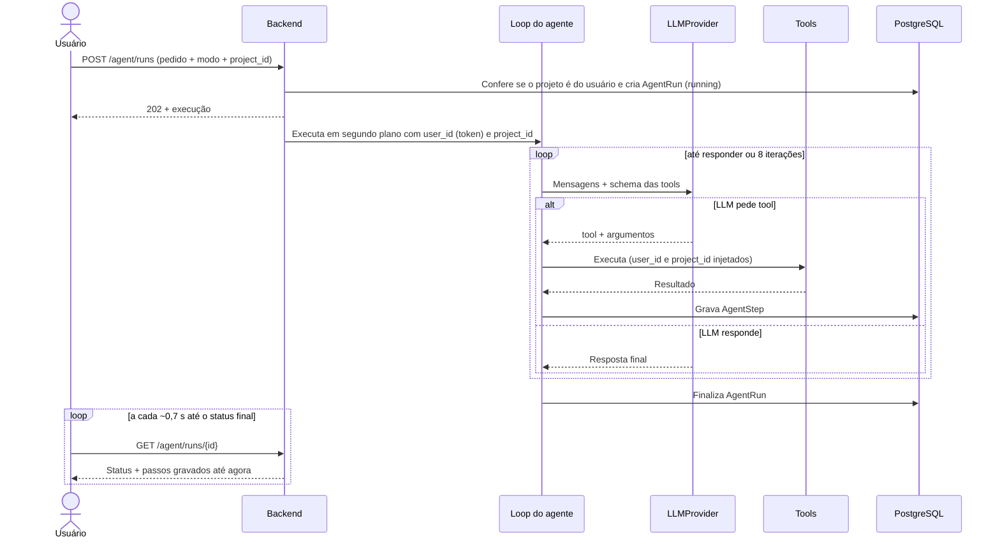
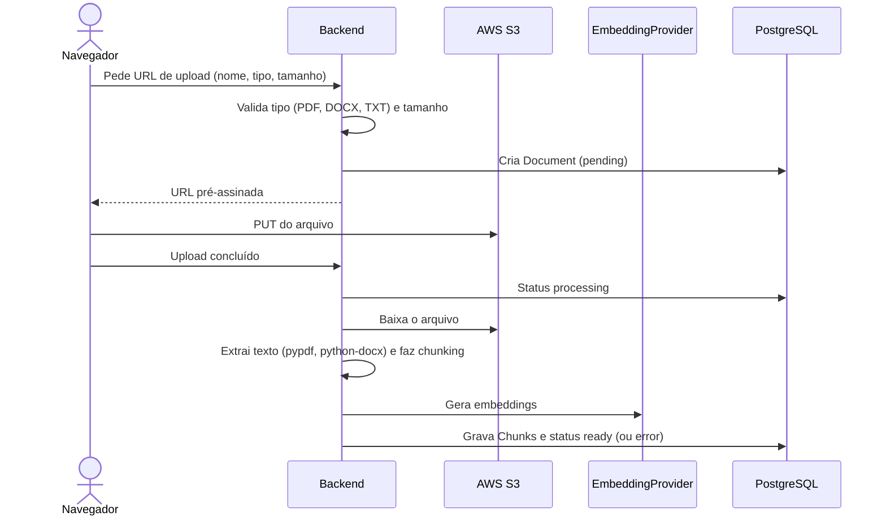

# Agente e RAG

> Status: **planejado**.

## Loop do agente

Implementado manualmente sobre o tool calling do SDK do provedor, **sem LangChain nem LlamaIndex** (ver [decisões](decisoes.md)).

- **Execução em segundo plano, passos ao vivo.** `POST /agent/runs` responde `202` na hora com `status: "running"` e o loop roda em segundo plano, gravando cada `AgentStep` assim que a tool termina. A tela consulta `GET /agent/runs/{id}` a cada ~0,7 s até o status final e mostra os passos conforme aparecem. Sem WebSocket nem SSE, e funciona com 2 réplicas, porque o estado fica no banco.
- **Máximo de 8 iterações.** Ao atingir o limite, a execução termina com `limit_reached` e o usuário é avisado. Várias tools pedidas pelo LLM na mesma resposta (ex.: adaptar para LinkedIn e para X) contam como uma iteração.
- **Erro numa tool:** a execução termina com `error`, e o passo que falhou guarda a mensagem em `error`.
- **Cada pedido é independente:** a conversa na tela é uma sequência de execuções; o agente não recebe o histórico das anteriores.
- **Prompts de sistema** separados por modo em `app/ai/agent/prompts/`.
- **Segurança:** o `user_id` e o `project_id` são injetados pelo backend em toda tool. Eles não aparecem no schema que o LLM vê: o agente só enxerga os dados do projeto em que foi chamado, e os documentos de um cliente nunca entram nos posts de outro.
- **Voz da marca:** o público-alvo e o tom de voz vêm do assunto; quando o assunto não define, valem os do projeto.
- **Rastreabilidade:** cada passo (tool, argumentos, duração, erro) vira log estruturado e registro em `AgentStep`.

## Modos

| Modo | Objetivo | Tools mais usadas |
| --- | --- | --- |
| Ideação (`ideation`) | Sugerir temas | `search_web`, `search_past_posts`, `analyze_performance`, `list_subjects` |
| Criação (`creation`) | Escrever o post completo | `get_subject`, `search_documents`, `search_past_posts`, `adapt_for_network`, `generate_image`, `save_draft` |

## Tools

Uma por arquivo em `app/ai/tools/`, com schema de entrada em Pydantic. Nomes em inglês (ver [decisão 20](decisoes.md)); as descrições que o LLM recebe podem ficar no idioma dos prompts.

| Tool | O que faz |
| --- | --- |
| `search_web(query)` | Busca no Tavily ou Brave, sempre retornando as fontes |
| `get_project()` | Dados do projeto atual: nome, descrição, público-alvo e tom de voz padrão |
| `list_subjects()` | Lista os assuntos do projeto |
| `get_subject(id)` | Detalhes do assunto, com público-alvo e tom de voz já resolvidos (do assunto ou, se vazios, do projeto) |
| `search_documents(query)` | RAG híbrido nos documentos do projeto |
| `search_past_posts(subject)` | Exemplos de estilo do projeto, só de posts aprovados ou publicados |
| `analyze_performance()` | Agregados do projeto por assunto, dia, horário, rede e imagem. Com menos de 5 posts no grupo, informa que os dados são insuficientes |
| `adapt_for_network(text, network)` | Ajusta formato e limite de caracteres da rede |
| `generate_image(prompt, format)` | Gera imagem sem texto dentro dela e salva no S3 |
| `save_draft(post)` | Salva o post com status `draft` (único status que o agente pode usar) |

## Provedores

O agente depende apenas das interfaces abaixo. As implementações ficam em `app/ai/providers/`.

| Interface | Responsabilidade |
| --- | --- |
| `LLMProvider` | Chat com tool calling (provedor **a definir**) |
| `EmbeddingProvider` | Vetores para chunks e consultas |
| `ImageProvider` | Geração de imagem |
| `VectorStore` | Busca híbrida (implementação: `PgVectorStore`) |

## Pipeline de documentos (RAG)

## Busca híbrida

`search_documents` combina:

1. **Similaridade vetorial** (pgvector, índice HNSW) sobre o embedding da consulta.
2. **Full-text** (`tsvector` em português) sobre o conteúdo.

Os dois rankings são combinados em uma lista única, por exemplo com Reciprocal Rank Fusion. A consulta **sempre** filtra por `user_id` e `project_id` (via `Document`).

## Testes

LLM, embeddings, imagem e busca web são **sempre mockados**, com respostas gravadas e determinísticas. Nenhum teste chama API paga ou depende de rede externa.
