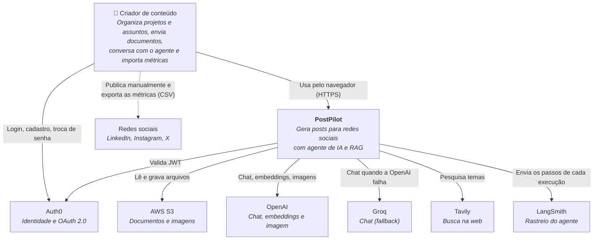
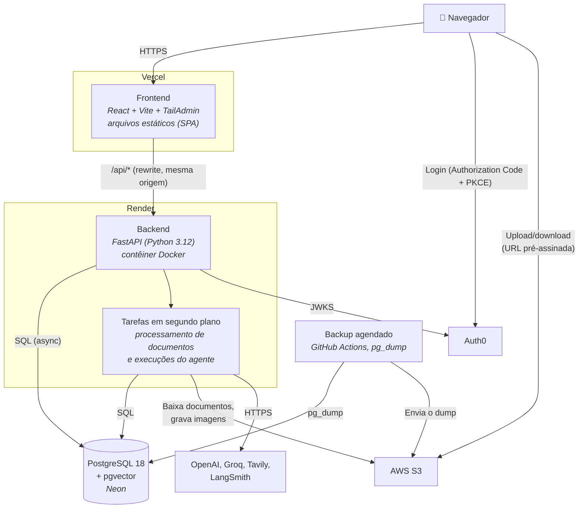
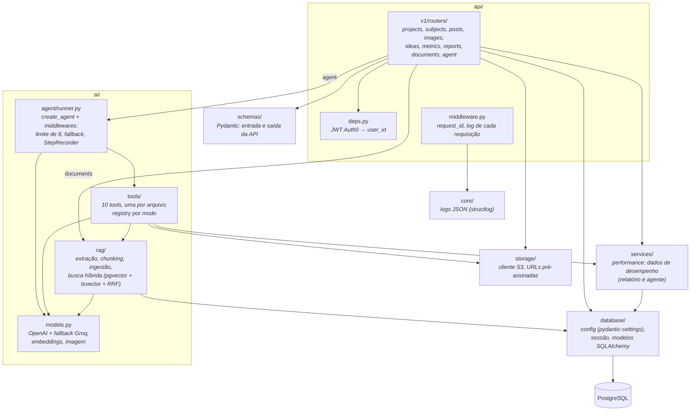

# Arquitetura (modelo C4)

> Status: **implementada**. Os diagramas refletem o código em produção (novembro de 2026). O modelo de implantação está em [implantacao.md](implantacao.md) e o diagrama de classes em [modelo-de-dados.md](modelo-de-dados.md).

## Nível 1: Contexto

Quem usa o sistema e com quais sistemas externos ele conversa.



A publicação nas redes e a coleta de métricas são feitas pelo próprio usuário: ele publica o post e depois importa o CSV que a rede exporta. A integração automática está fora do escopo (roadmap).

## Nível 2: Contêineres



Pontos importantes:

- O frontend obtém o token no Auth0 e o envia como `Authorization: Bearer` em cada chamada à API. O backend valida assinatura, emissor e audiência pelo JWKS.
- Os arquivos vão **direto do navegador para o S3**, com URL pré-assinada gerada pelo backend. O backend nunca recebe o upload.
- No banco fica só a **chave** do objeto S3, nunca a URL.
- O processamento de documentos e o loop do agente rodam em segundo plano no mesmo processo (`BackgroundTasks` do FastAPI). A API responde `202` na hora e o frontend consulta o andamento, que fica no banco.

## Nível 3: Componentes do backend



Regras de dependência:

- **Escopo sempre do token:** o `user_id` vem de `api/deps.py` (JWT validado) e o projeto é conferido antes de qualquer leitura. As tools recebem `user_id` e `project_id` por um contexto (`AgentContext`) que o LLM não vê nem altera.
- **IA atrás de interfaces:** o agente depende só de `BaseChatModel`, `Embeddings` e de um gerador de imagens injetado; os modelos concretos são criados apenas em `ai/models.py`. Nos testes, entram modelos falsos.
- **Simplificação deliberada:** os routers usam a sessão do SQLAlchemy diretamente (sem camada de repositórios), porque cada recurso é um CRUD pequeno. O que é compartilhado entre a API e o agente fica em `services/` (ex.: os dados de desempenho) ou nas funções `*_data` de cada tool.
- **Configuração** só por variáveis de ambiente (`database/config.py`); **logs** só em JSON no stdout.

## Componentes do frontend

```
src/
├── pages/          # uma página por rota (React Router), carregadas sob demanda
├── components/     # layout, cabeçalho (seletor de projeto, saúde, usuário) e UI do TailAdmin
├── features/       # um módulo por recurso: projects, subjects, posts, images, ideas,
│   │               # documents, agent, metrics, dashboard, calendar, art, health...
│   ├── */service.ts  # chamadas HTTP (ou a API fictícia no modo de demonstração)
│   └── */api.ts      # hooks TanStack Query: única forma de as telas chamarem a API
├── lib/            # cliente HTTP com o token, Auth0 (login, saída por inatividade), formatação
├── locales/        # textos da interface em pt-BR e en (i18next)
└── test/           # API falsa (MSW) e testes de integração
```

- **Projeto atual:** escolhido no cabeçalho e guardado no navegador; toda listagem envia `project_id`.
- **Sem segredos no frontend:** só variáveis públicas (`VITE_AUTH0_*`, URL da API). As chaves de IA ficam no backend.
