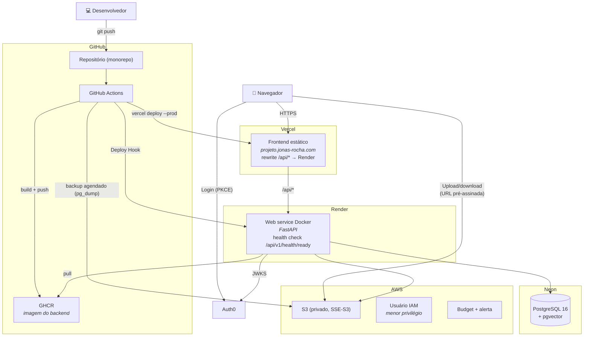
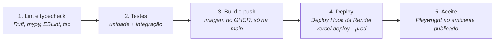

# Implantação, CI/CD e IaC

> Status: **planejada**. Plataformas definidas na [decisão 28](decisoes.md) (substitui a VPS com k3s). Não altere recursos em produção sem revisar antes o `terraform plan`.

## Modelo de implantação

- **Uma só origem:** o domínio aponta para a Vercel, que repassa `/api/*` para a Render. O navegador não faz chamadas entre origens, então o CORS da API fica vazio em produção.
- **Render gratuita:** dorme depois de cerca de 15 minutos sem uso, e a primeira requisição leva de 30 a 60 s. Antes de uma apresentação, abra o app (ou chame `/api/v1/health`) um minuto antes.
- **Neon gratuito:** pouco armazenamento e pausa sem uso; usar a connection string com SSL nas variáveis da Render.

## Pipeline (GitHub Actions)

- Em pull requests, só as etapas 1 e 2.
- O deploy automático da Vercel e da Render fica **desligado**: só o pipeline publica, e só com lint e testes passando.

## Artefatos de IaC

| Ferramenta | Pasta | Responsabilidade |
| --- | --- | --- |
| Terraform | `infra/terraform/` | **AWS:** bucket S3 (Block Public Access, SSE-S3, CORS com `GET` e `PUT` só para o domínio de produção e `localhost`, lifecycle de uploads incompletos), usuário IAM (`GetObject`, `PutObject`, `DeleteObject` neste bucket), AWS Budget, estado remoto. **Vercel, Render e Neon:** projetos, serviço, banco e variáveis de ambiente, pelos providers de cada plataforma |
| GitHub Actions | `.github/workflows/` | Pipeline e backup agendado (`pg_dump` do Neon para o S3) |

## Configuração e segredos

- Configuração só por variáveis de ambiente (pydantic-settings). O `.env.example` lista todas.
- Em produção, os segredos ficam nas variáveis de ambiente da Render e da Vercel (definidas pelo Terraform). No pipeline, em GitHub Secrets (tokens da Vercel e da Render, Deploy Hook, credenciais da AWS).
- `AUTH_DEV_USER` fica **vazio** em produção, para a API sempre exigir token.
- Nunca commitar `.env` ou chaves.

## Logs

JSON no stdout (structlog), com `request_id` e `user_id` quando houver. Sem arquivos de log. Tokens, chaves e conteúdo completo de documentos nunca são registrados.

## Backup

Job agendado no GitHub Actions (`schedule`) que roda `pg_dump` no Neon e envia o dump para o S3. O Neon também guarda um histórico curto para restauração (point-in-time) no plano gratuito.
