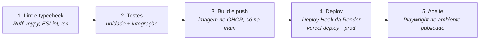

# Implantação, CI/CD e IaC

> Status: **em implantação**. Plataformas definidas na [decisão 28](decisoes.md) (substitui a VPS com k3s). Prontos: contas da Neon, Render e Vercel, domínio `postpilot.jonas-rocha.com` (Cloudflare → Vercel), URLs de produção no Auth0 e a parte da AWS pelo Terraform. Faltam o Dockerfile, o serviço na Render, o `vercel.json` e o pipeline. Não altere recursos em produção sem revisar antes o `terraform plan`.

## Modelo de implantação


- **Uma só origem:** o domínio aponta para a Vercel, que repassa `/api/*` para a Render. O navegador não faz chamadas entre origens, então o CORS da API fica vazio em produção.
- **Render gratuita:** dorme depois de cerca de 15 minutos sem uso, e a primeira requisição leva de 30 a 60 s. Antes de uma apresentação, abra o app (ou chame `/api/v1/health`) um minuto antes.
- **Neon gratuito:** pouco armazenamento e pausa sem uso; usar a connection string com SSL nas variáveis da Render.

## Pipeline (GitHub Actions)



- Em pull requests, só as etapas 1 e 2.
- O deploy automático da Vercel e da Render fica **desligado**: só o pipeline publica, e só com lint e testes passando.

## Artefatos de IaC

| Ferramenta | Pasta | Responsabilidade |
| --- | --- | --- |
| Terraform | `infra/terraform/` | **AWS:** bucket S3 do app (Block Public Access, SSE-S3, CORS com `GET`, `HEAD` e `PUT` só para o domínio de produção e `localhost:5173`, lifecycle de uploads incompletos), usuário IAM do backend com menor privilégio, AWS Budget com alerta por e-mail. Estado remoto no S3 |
| GitHub Actions | `.github/workflows/` | Pipeline e backup agendado (`pg_dump` do Neon para o S3) |

**Vercel, Render e Neon** foram configurados pelo painel de cada plataforma, não pelo Terraform: são poucos recursos, criados uma vez, e os providers dessas plataformas pediriam mais tokens e tempo a poucos dias do prazo. Fica no roadmap trazê-los para o Terraform.

### Terraform

| Arquivo | Conteúdo |
| --- | --- |
| `versions.tf` | Terraform ≥ 1.10, provider `hashicorp/aws ~> 6.0` e o backend `s3` |
| `providers.tf` | Região e tags padrão (`Project`, `ManagedBy`) em todos os recursos |
| `variables.tf` | `region`, `app_origins` (CORS), `budget_limit_usd` (5) e `budget_email` |
| `s3.tf` | Bucket `postpilot-prod-<conta>` com Block Public Access, SSE-S3, CORS e lifecycle |
| `iam.tf` | Usuário `postpilot-backend`: `GetObject`, `PutObject` e `DeleteObject` nos objetos do bucket e `ListBucket` no bucket; chave de acesso para a Render |
| `budget.tf` | US$ 5 por mês: e-mail com 80% gasto e com previsão de passar de 100% |
| `outputs.tf` | Bucket, região e a chave do backend (o segredo é `sensitive`) |

- **Estado remoto:** bucket `postpilot-tfstate-<conta>` (versionado, privado), criado uma vez pela AWS CLI, porque o Terraform não guarda o estado num bucket que ele mesmo ainda vai criar. A trava usa o lockfile nativo do S3 (`use_lockfile`), sem DynamoDB.
- **`ListBucket`:** sem ela, um `HEAD` num objeto que não existe responde `403` em vez de `404`, e o `POST /images` responderia `500` em vez de "Image was not uploaded".
- **Segredo da chave do backend:** fica no estado (bucket privado e criptografado) e só sai com `terraform output -raw backend_secret_access_key`, direto para as variáveis da Render.
- No Git vão os `.tf` e o `.terraform.lock.hcl`; `.terraform/`, `*.tfstate` e `tfplan` ficam no `.gitignore`.

```powershell
cd infra/terraform
terraform init
terraform plan -var "budget_email=<e-mail>" -out tfplan   # revisar
terraform apply tfplan
terraform output
```

## Configuração e segredos

- Configuração só por variáveis de ambiente (pydantic-settings). O `.env.example` lista todas.
- Em produção, os segredos ficam nas variáveis de ambiente da Render e da Vercel (definidas no painel de cada uma). No pipeline, em GitHub Secrets (tokens da Vercel e da Render, Deploy Hook, credenciais da AWS).
- `AUTH_DEV_USER` fica **vazio** em produção, para a API sempre exigir token.
- Nunca commitar `.env` ou chaves.

## Logs

JSON no stdout (structlog), com `request_id` e `user_id` quando houver. Sem arquivos de log. Tokens, chaves e conteúdo completo de documentos nunca são registrados.

## Backup

Job agendado no GitHub Actions (`schedule`) que roda `pg_dump` no Neon e envia o dump para o S3. O Neon também guarda um histórico curto para restauração (point-in-time) no plano gratuito.
