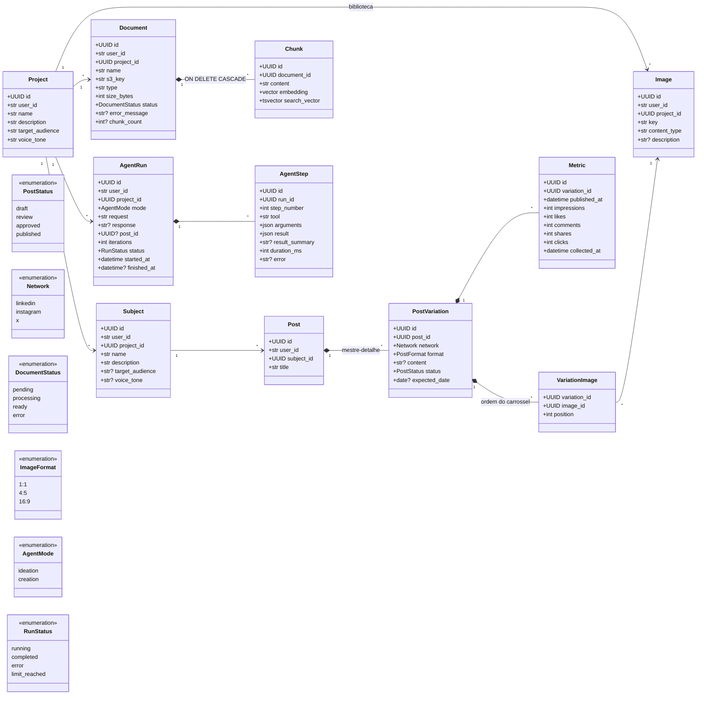

# Modelo de dados

> Status: **em implementação** (`projects`, `subjects`, `posts` e `images` já têm migration). IDs são UUID, gerados pelo backend. Toda mudança de modelo vem com migration Alembic revisada à mão. Atualize este diagrama junto.

Nomes de classes, tabelas, colunas e valores de enum ficam em **inglês** (ver [decisão 20](decisoes.md)). A interface traduz os valores para o usuário (ex.: `draft` aparece como "Rascunho").

Todas as entidades do usuário têm `user_id` (o `sub` do Auth0), `created_at` e `updated_at`. Todas as consultas filtram por `user_id`.

O **Project** (a marca do próprio usuário ou um cliente) é o topo da hierarquia: subjects, documents e agent runs pertencem a um projeto, e os posts pertencem a ele através do subject. Assim, o conteúdo e os documentos de um cliente nunca se misturam com os de outro.

## Glossário

| Domínio (interface) | Classe | Tabela |
| --- | --- | --- |
| Projeto | `Project` | `projects` |
| Assunto | `Subject` | `subjects` |
| Post | `Post` | `posts`: a ideia (título e assunto). O que muda por rede fica nas variações ([decisão 30](decisoes.md)). |
| Variação do post | `PostVariation` | `post_variations`: o post adaptado para uma rede (`network`: `instagram`, `linkedin`, `x`), com **formato** (`format`: `text`, `single`, `carousel`), texto, imagens, **status** e **data** próprios. Regras de cada rede em [api.md](api.md). |
| Imagem | `Image` | `images` |
| Ideia | `Idea` | `ideas`: um possível post, antes de escrever ([decisão 31](decisoes.md)) |
| Métrica | `Metric` | `metrics` |
| Documento | `Document` | `documents` |
| Trecho (chunk) | `Chunk` | `chunks` |
| Execução do agente | `AgentRun` | `agent_runs` |
| Passo do agente | `AgentStep` | `agent_steps` |

## Diagrama de classes

## Regras

| Entidade | Regra |
| --- | --- |
| Project | CRUD completo. Define o público-alvo e o tom de voz padrão. Só pode ser excluído quando não tem subjects, documents nem images (a API responde `409` caso contrário), para evitar apagar conteúdo e arquivos no S3 por engano. |
| Subject | CRUD completo (requisito do TCC). Pertence a um projeto. `target_audience` e `voice_tone` são opcionais: quando vazios, valem os do projeto. Só pode ser excluído sem posts (`409` caso contrário). |
| Post | CRUD completo. Status: `draft` → `review` (aguardando revisão) → `approved` → `published`, guardado como enum nativo do Postgres (`post_status`). O agente só cria com status `draft`; enviar para revisão, aprovar e publicar é ação do usuário. Não tem `project_id`: o projeto vem do subject (`post → subject → project`), evitando dados duplicados que podem ficar inconsistentes. |
| PostVariation | Editada na mesma tela do Post (mestre-detalhe, requisito do TCC). No máximo uma variação por rede em cada post, e pelo menos uma. Ao salvar o post, a variação de uma rede que continua mantém o `id` (as imagens e métricas ficam ligadas a ele). `char_count` conta texto + hashtags e não pode passar do limite da rede (LinkedIn 3000, Instagram 2200, X 280). |
| Image | Biblioteca de imagens do **projeto** ([decisão 22](decisoes.md)); cada variação do post escolhe as suas, em ordem (`variation_images`: `variation_id`, `image_id`, `position`). Guarda só a chave S3 (`users/{user_id}/projects/{project_id}/images/{uuid}.png`), nunca a URL. PNG, JPEG ou WebP até 5 MB. Só pode ser excluída quando nenhuma variação de post a usa, nem num carrossel (`409`); a exclusão apaga também o objeto no S3. |
| Idea | Escopo por projeto. `title` obrigatório; `notes`, `subject_id` (do mesmo projeto) e `networks` (lista de redes sugeridas) opcionais. `source`: `manual` ou `agent` (o modo Ideação do agente cria ideias). `post_id` aponta para o post criado a partir dela (`null` = aberta); apagar o post deixa a ideia aberta de novo (`ON DELETE SET NULL`), e apagar a ideia não mexe no post. |
| Metric | Uma coleta registrada pelo usuário (manualmente ou importada do CSV da rede, decisão 32), só com a variação `published`. Os números são totais acumulados no momento da coleta; a mais recente é a que vale. `collected_at` não pode ser antes de `published_at` nem no futuro. Taxa de engajamento = (likes + comments + shares + clicks) ÷ impressions. Apagada junto com a variação. |
| Document | Pertence a um projeto e só é usado pelo RAG desse projeto. O status acompanha o processamento: `pending` → `processing` → `ready` ou `error`. Chave S3: `users/{id}/projects/{id}/documents/{uuid}.{ext}`. |
| Chunk | Apagado em cascata com o Document. A dimensão do `embedding` vem da configuração; trocar o modelo de embeddings exige reprocessar tudo. Índices: HNSW no `embedding` e GIN no `search_vector`. |
| AgentRun | Criada como `running` e atualizada pelo loop em segundo plano. `post_id` aponta para o rascunho salvo pelo agente (modo `creation`). |
| AgentStep | Um registro por tool chamada, gravado assim que a tool termina (é o que a tela mostra ao vivo). `result` guarda a saída completa; `result_summary` é o texto curto exibido. |
