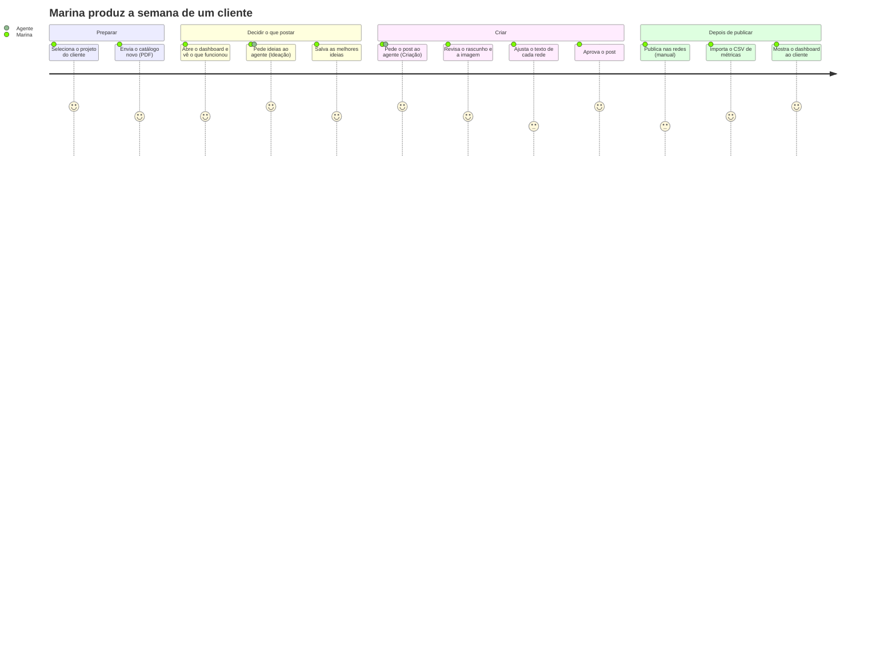
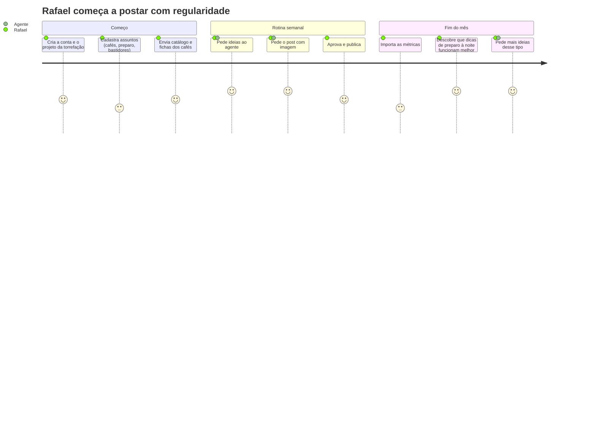

# Descoberta de produto

Entregas de descoberta do TCC: Lean Canvas, personas, jornadas dos usuários e mapeamento de histórias. Elas explicam **para quem** o PostPilot existe e **por que** as funcionalidades foram priorizadas nesta ordem. A solução técnica está em [arquitetura.md](arquitetura.md).

## Lean Canvas

| Bloco | Conteúdo |
| --- | --- |
| **Problema** | 1. Escrever posts frequentes, na voz da marca e adaptados a cada rede, toma horas por semana. 2. O conteúdo fica genérico porque não usa o material próprio da marca (catálogos, apresentações, artigos). 3. Quem atende vários clientes mistura tons e informações entre eles. 4. As métricas dos posts anteriores raramente orientam o que publicar em seguida. |
| **Alternativas atuais** | ChatGPT e similares (sem o material nem a voz da marca, sem histórico), planilhas de calendário editorial, ferramentas de agendamento (Buffer, mLabs) que publicam mas não escrevem, agências. |
| **Segmentos de clientes** | Social media freelancers e pequenas agências que atendem vários clientes; pequenas empresas e profissionais liberais que cuidam das próprias redes. **Early adopters:** social media freelancers com 3 a 10 clientes. |
| **Proposta única de valor** | Posts prontos para cada rede, escritos a partir dos documentos e da voz de cada cliente, com sugestões guiadas pelo que já funcionou. |
| **Solução** | Projetos isolados por cliente; documentos indexados para RAG; agente de IA com modos Ideação e Criação, busca na web e geração de imagem; post com uma variação por rede; importação das métricas e dashboard de desempenho que alimenta o agente. |
| **Canais** | Portfólio e LinkedIn do autor, comunidades de social media, conteúdo gerado com a própria ferramenta, indicação entre freelancers. |
| **Fontes de receita** | Assinatura mensal por número de projetos (clientes) e de execuções do agente; plano gratuito limitado para experimentar. |
| **Estrutura de custos** | APIs de IA por uso (chat, embeddings, imagem, busca web), hospedagem (Vercel, Render, Neon, S3), Auth0, domínio. No TCC, tudo em planos gratuitos com alerta de orçamento na AWS. |
| **Métricas-chave** | Posts gerados por semana, % de rascunhos do agente aprovados sem grandes mudanças, tempo da ideia ao post aprovado, projetos ativos por usuário, retenção mensal. |
| **Vantagem injusta** | O contexto acumulado de cada cliente (documentos, posts aprovados e desempenho) torna as sugestões melhores com o uso e é difícil de reproduzir num chat genérico. |

## Personas

### Marina, social media freelancer (persona principal)

| | |
| --- | --- |
| **Perfil** | 29 anos, Belo Horizonte. Atende 6 clientes pequenos (uma cafeteria, uma clínica, uma loja de roupas, dois escritórios e uma escola de idiomas). |
| **Objetivos** | Entregar o calendário de cada cliente sem trabalhar à noite; manter a voz de cada marca; mostrar resultados nas reuniões mensais. |
| **Frustrações** | Passa horas lendo materiais dos clientes para escrever poucos posts; o ChatGPT devolve textos genéricos e às vezes mistura informações de clientes; reescreve o mesmo post para cada rede; monta relatórios de métricas à mão em planilhas. |
| **Como o PostPilot ajuda** | Um projeto por cliente, com documentos e tom de voz próprios; o agente escreve com base no material do cliente e adapta para cada rede; o dashboard mostra o que funciona por rede, assunto e horário. |
| **Frase** | "Eu sei o que cada cliente quer dizer. O que me falta é tempo para escrever tudo isso três vezes." |

### Rafael, dono de pequena empresa

| | |
| --- | --- |
| **Perfil** | 41 anos, dono de uma torrefação de cafés especiais com loja online. Cuida das redes sozinho, no fim do dia. |
| **Objetivos** | Publicar com regularidade no Instagram e no LinkedIn para vender mais e atrair parceiros (cafeterias, empresas). |
| **Frustrações** | Não sabe o que postar; fica semanas sem publicar; não tem tempo de aprender cada rede; não sabe se os posts dão resultado. |
| **Como o PostPilot ajuda** | O modo Ideação sugere temas a partir de tendências e do que já deu certo; o modo Criação escreve com base nos catálogos que ele já tem e gera a imagem; ele só revisa e aprova. |
| **Frase** | "Eu entendo de café, não de algoritmo." |

## Jornadas dos usuários

### Marina: do pedido do cliente ao post aprovado (com o PostPilot)

**Antes do PostPilot**, a mesma semana tinha etapas com nota baixa: ler o material do cliente (2), escrever do zero (2), reescrever para cada rede (1) e montar o relatório numa planilha (1). As etapas que continuam com nota 3 (publicar manualmente, ajustar o texto) são candidatas ao roadmap: publicação automática e edição assistida.

### Rafael: da falta de ideias ao primeiro mês com regularidade

## Mapeamento de histórias de usuário

As atividades (colunas) seguem a jornada. Cada linha é uma entrega: o **MVP** é o que o TCC exige e está em produção; a **versão 1.1** foi entregue em seguida; o **roadmap** fica para depois do TCC (ver "Fora do escopo" no [README](../README.md)).

| | Organizar clientes | Alimentar o contexto | Decidir o que postar | Criar o post | Acompanhar resultados |
| --- | --- | --- | --- | --- | --- |
| **MVP (TCC)** | Criar conta e entrar (Auth0) · CRUD de projetos · CRUD de assuntos com público e tom | Enviar PDF, DOCX e TXT · Indexar para RAG | Agente em modo Ideação com busca na web | Agente em modo Criação com RAG · Post com uma variação por rede (mestre-detalhe) · Rascunho salvo pelo agente | Ver os passos de cada execução do agente |
| **Versão 1.1** | Trocar de projeto no cabeçalho · Saída automática por inatividade | Biblioteca de imagens do projeto | Ideias salvas (manuais e do agente) · Sugestões guiadas pelo desempenho | Imagem gerada pelo agente · Editor de arte (texto sobre cor ou foto, carrossel) · Calendário pela data prevista · Guia de boas práticas por rede | Importar métricas por CSV · Dashboard por rede, assunto e dia × horário |
| **Roadmap** | Equipes e permissões por cliente | Importar de URLs e do Google Drive | Calendário editorial sugerido pelo agente | Edição assistida do texto · Publicação automática nas redes | Métricas pelas APIs das redes · Relatório mensal gerado por IA para o cliente |

### Histórias do MVP (formato "como… quero… para…")

| # | História | Critério de aceite | Onde está |
| --- | --- | --- | --- |
| H1 | Como social media, quero um projeto por cliente para não misturar marcas | Listas e agente só enxergam o projeto atual; projeto de outro usuário responde 404 | `/projects`, testes de autorização |
| H2 | Como social media, quero cadastrar assuntos com público e tom para orientar o agente | CRUD completo; campos vazios herdam os do projeto | `/subjects` |
| H3 | Como social media, quero escrever um post com uma variação por rede na mesma tela | Mestre-detalhe; regras de limite e formato de cada rede | `/posts/new` |
| H4 | Como dono de empresa, quero enviar meus catálogos para o agente usar | Upload direto ao S3; status até "pronto"; busca híbrida | `/documents` |
| H5 | Como dono de empresa, quero ideias de posts com base em tendências | Ideação cita as fontes da web; não salva nada | `/agent` |
| H6 | Como social media, quero que o agente escreva o post a partir dos documentos | Rascunho com uma variação por rede, sempre `draft`, link para abrir | `/agent` |
| H7 | Como social media, quero ver o que funcionou para decidir os próximos posts | Dashboard por rede, assunto e horário; grupos com menos de 5 posts marcados | `/dashboard`, `/metrics` |

Os testes de aceite (Playwright) cobrem H1, H2, H3 e a importação de métricas de H7; documentos (H4) e o agente (H5, H6) são cobertos por testes de integração com modelos de IA falsos ([testes.md](testes.md)).
